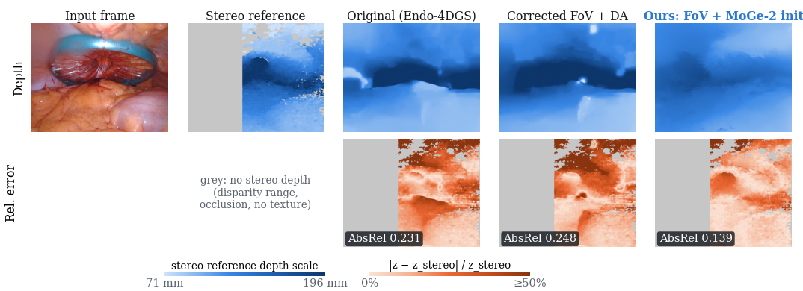
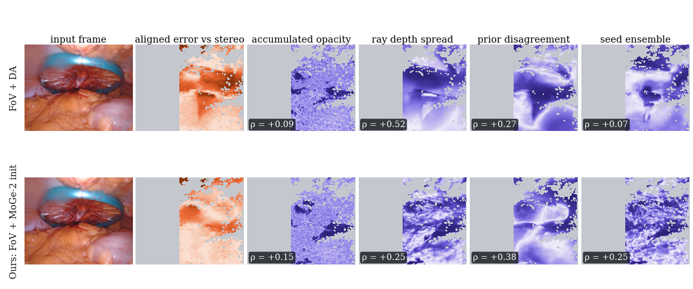

# Getting the Surface Right: Scale-Corrected Monocular Geometry Priors for Endoscopic 4D Gaussian Splatting

Code, results and paper sources for a study of monocular 4D Gaussian splatting on endoscopic video
([Endo-4DGS](https://github.com/lastbasket/Endo-4DGS)) that evaluates not only image quality but also
agreement of the rendered depth with stereo-reference depth, and explains where that depth disagrees.

**Main findings (StereoMIS, 3 seeds each):**

- The released StereoMIS preprocessing renders P1 with a 34.2° instead of the true 58.7° field of view.
- MoGe-2's metric depth is 6–18× too large on endoscopic images; we estimate its scale from the known camera
  poses and inter-frame matches (no stereo).
- Correcting the intrinsics and using the scaled MoGe-2 prior **only to initialise** the Gaussians
  improves PSNR from 31.98 to 32.40 dB and reduces the per-frame scale-aligned depth error (AbsRel vs. stereo)
  by 37 % (0.234 → 0.148) on P1, with a slightly worse LPIPS (0.189 vs. 0.178). With a scale estimated
  from training frames only: 32.29 dB / 0.147.
- Among five per-pixel signals, the accumulated opacity that Endo-4DGS uses as confidence ranks depth errors
  weakly (≤ 17 % of the attainable gain), while disagreement with the monocular prior is the strongest (34–65 %).

Full paper: [`docs/paper.pdf`](docs/paper.pdf) · response to an internal review: [`docs/response_to_review.pdf`](docs/response_to_review.pdf)

<p align="center"></p>

## Repository layout

```
setup/          install_endo4dgs.sh (upstream clone + patch + overlay), conda environment files
patches/        endo4dgs_39c6ce2.patch   changes to 7 upstream files (commit 39c6ce2)
overlay/        new files copied into the Endo-4DGS tree
  arguments/    configs: stereomis_moge.py, stereomis_mogesc.py, stereomis_priornormal.py
  scripts/      pre_moge_dep.py (MoGe-2 prior), run_stereomis_exp.sh (train+render+evaluate one run)
  stereomis/    data preparation, scale estimation, evaluation, uncertainty benchmark, pose refinement
experiments/    01–05: the exact commands behind every table and figure
paper/          LaTeX sources, figure/table generators, build script
results/        all numbers reported in the paper (results.tsv, JSON summaries, scale factors)
figures/        key figures (PNG)
docs/           compiled paper and review response
```

### What the patch changes in Endo-4DGS

| File | Change |
|---|---|
| `arguments/__init__.py` | `depth_prior` option (reads `depth_<prior>/`), `prior_normal` flag and weight |
| `scene/__init__.py`, `scene/dataset_readers.py`, `scene/endo_loader.py` | pass `depth_prior` to the loader; skip invalid prior pixels at initialisation |
| `gaussian_renderer/__init__.py` | optional camera-frame normal rendering (normal-loss ablation) |
| `train.py` | `--seed`; optional MoGe-2 normal loss |
| `utils/general_utils.py` | seed argument |

With default options the training code path of upstream Endo-4DGS is unchanged.

### New scripts (`overlay/`)

| Script | Purpose |
|---|---|
| `stereomis/make_split.py` | P1 frames 801–1000 split; `--rectified_focal` writes the corrected focal length |
| `stereomis/prepare_sequence.py` | any StereoMIS clip: rectified left/right images, masks, poses, `calib.json` |
| `scripts/pre_moge_dep.py` | MoGe-2 metric depth/normals/points (run in the `moge` env) |
| `stereomis/estimate_prior_scale.py` | prior scale from known-pose triangulation, with train-only pool and geometric filters |
| `stereomis/fit_stereo_scale.py` | stereo-fitted prior scale (stereo-assisted protocol) |
| `stereomis/eval_depth_stereo.py` | rendered depth vs. SGBM stereo (per-frame scale-aligned AbsRel, δ<1.25), optional left–right check |
| `stereomis/eval_depth_extended.py` | aligned, fixed-scale and metric depth error; per-frame scale statistics |
| `stereomis/eval_priors.py` | accuracy of the priors alone |
| `stereomis/uncertainty_bench.py` | five per-pixel uncertainty signals vs. depth error: AUSE/AURG, Spearman, deciles, region attribution |
| `stereomis/refine_poses.py` | COLMAP bundle adjustment of the robot poses (ablation) |
| `stereomis/dump_frame.py` | depth maps for the qualitative figure |
| `scripts/run_stereomis_exp.sh` | train → render → metrics → stereo depth check for one configuration and seed |

## Environment

Tested on Ubuntu 24.04, RTX 4060 Ti 16 GB, i9-12900K, 62 GB RAM.

1. **Code:** `bash setup/install_endo4dgs.sh` (creates `./Endo-4DGS`; needs `git`).
2. **Endo-4DGS environment** (Python 3.8, PyTorch 2.0.0 + CUDA 11.8):
   `conda env create -f setup/environment_endo4dgs.yml`, then inside `Endo-4DGS/`:
   ```bash
   conda activate ED4DGS
   conda install -c conda-forge libxcrypt          # crypt.h needed to compile the CUDA extensions
   export CUDA_HOME=$CONDA_PREFIX CPATH=$CONDA_PREFIX/include TORCH_CUDA_ARCH_LIST="8.9"   # set your GPU arch
   pip install -e submodules/diff-gaussian-rasterization-depth
   pip install -e submodules/simple-knn
   conda env config vars set LD_LIBRARY_PATH=$CONDA_PREFIX/lib CUDA_HOME=$CONDA_PREFIX   # cuDNN needs libnvrtc.so
   ```
   Notes: `opencv-python==4.10.0.84` is required (OpenCV 5 breaks the authors' `stereoRectify` call).
   Download `depth_anything_vitb14.onnx` from the [Depth-Anything-ONNX v1.0.0 release](https://github.com/fabio-sim/Depth-Anything-ONNX/releases)
   into `submodules/depth_anything/weights/` (the released `scripts/pre_dam_dep.py` loads ViT-B).
3. **MoGe-2 environment** (Python 3.10, PyTorch 2.4.1 + CUDA 12.1), using MoGe at the last pre-MoGe-3 commit:
   ```bash
   conda env create -f setup/environment_moge.yml
   conda activate moge
   git clone https://github.com/microsoft/MoGe.git && cd MoGe && git checkout 925b8ed && pip install -e .
   ```
   The weights `Ruicheng/moge-2-vitl-normal` are downloaded from Hugging Face on first use.
4. **COLMAP** (only for the pose-refinement ablation): `colmap` on `PATH`, or pass `--colmap`.

## Reproducing the results

Run from the repository root; set `REPO` if Endo-4DGS is elsewhere.

| Step | Script | Env | Produces |
|---|---|---|---|
| 1 | `experiments/01_prepare_data.sh` | ED4DGS | StereoMIS download (10 GB), P1/P2_5 splits, Depth-Anything priors |
| 1b | `experiments/01b_moge_priors.sh` | moge | MoGe-2 priors |
| 1c | `experiments/01c_scales.sh` | ED4DGS | prior scales (×0.0928, ×0.1044 clean, ×0.1645/×0.0572 stereo) + sensitivity |
| 2 | `experiments/02_train_p1.sh` | ED4DGS | Tables III–IV (P1) |
| 3 | `experiments/03_pose_refinement.sh` | ED4DGS + COLMAP | Table IV, pose ablation |
| 4 | `experiments/04_train_p25.sh` | ED4DGS | Table VII (P2_5) |
| 5 | `experiments/05_evaluate.sh` | ED4DGS | Tables V, VI, VIII; data for Figs. 4–10 |
| 6 | `cd paper && python make_main_figs.py && python make_expl_figs.py --src ../Endo-4DGS/output/stereomis/uncertainty_v2 --tag p1 && python make_expl_figs.py --src ../Endo-4DGS/output/stereomis/uncertainty_v2 --tag p25 && python make_unc_table.py && python make_main_table.py && python build_full_paper.py` | ED4DGS + LaTeX | figures, tables, `full_paper_revised.pdf` |

Every training run appends one row to `Endo-4DGS/output/stereomis/results.tsv`
(name, seed, PSNR, SSIM, LPIPS, AbsRel, δ<1.25). A run takes about 16 minutes on an RTX 4060 Ti.
Our own values are in [`results/`](results/); in our runs, seed 0 of the original setup and of the
stereo-scaled P1 run were trained before the runner existed (`output/stereomis/split_1`,
`output/stereomis/split_1_mogesc`), which is why `results.tsv` lists only seeds 1–2 for them.

## Results

**StereoMIS P1, frames 801–1000** (mean ± s.d., 3 seeds; AbsRel = per-frame scale-aligned, vs. SGBM stereo)

| Setup | PSNR | SSIM | LPIPS | AbsRel | δ<1.25 |
|---|---|---|---|---|---|
| Original (reproduced, released code) | 31.98 ± 0.09 | 0.8515 | 0.178 | 0.234 | 0.603 |
| + corrected FoV (Depth-Anything) | 32.33 ± 0.14 | 0.8536 | 0.186 | 0.235 | 0.611 |
| + corrected FoV, DA init only | 32.62 ± 0.13 | 0.8598 | 0.166 | 0.376 | 0.404 |
| + corrected FoV, MoGe-2 + depth loss | 31.87 ± 0.13 | 0.8436 | 0.216 | 0.155 | 0.778 |
| **Ours: corrected FoV, MoGe-2 init (×0.093)** | 32.40 ± 0.10 | 0.8526 | 0.189 | **0.148** | **0.795** |
| Ours, held-out-clean scale (×0.104) | 32.29 ± 0.06 | 0.8506 | 0.194 | 0.147 | 0.799 |

**StereoMIS P2_5, frames 5301–5499 (every 2nd), static camera**

| Setup | PSNR | SSIM | LPIPS | AbsRel |
|---|---|---|---|---|
| Original | 26.70 | 0.729 | 0.184 | 0.063 |
| + corrected FoV (DA) | 27.89 | 0.778 | 0.168 | 0.064 |
| + MoGe-2 init, unscaled (monocular) | 27.95 | 0.776 | 0.201 | 0.046 |
| + MoGe-2 init, stereo-fitted scale | 28.66 | 0.807 | 0.153 | 0.046 |

Important limitations: the depth metric measures shape agreement with an *estimated* stereo reference;
our P1 reconstructions are not metric (raw depth ≈1.9× too shallow relative to stereo); the study covers two
short clips. See the paper for the full discussion.

<p align="center"></p>

## Data and licences

- **StereoMIS** (Hayoz et al., IPCAI 2023) is downloaded from [Zenodo 7727692](https://zenodo.org/records/7727692) and is not redistributed here.
- **Endo-4DGS** is not redistributed; `setup/install_endo4dgs.sh` clones it and applies our patch. Endo-4DGS builds on
  3D Gaussian Splatting (Inria) and 4D Gaussians; its licence (`LICENSE.md` in that repository) applies to the
  patched files.
- **MoGe-2** (Microsoft, MIT licence) and **Depth-Anything** weights are downloaded from their sources.
- The licence for the new code in this repository has not been chosen yet; add a `LICENSE` file before publishing.

## Citation

If you use this work, please also cite Endo-4DGS (Huang et al., MICCAI 2024), MoGe-2 (Wang et al., 2025) and
StereoMIS (Hayoz et al., IPCAI 2023); full references are in [`paper/refs.bib`](paper/refs.bib).
